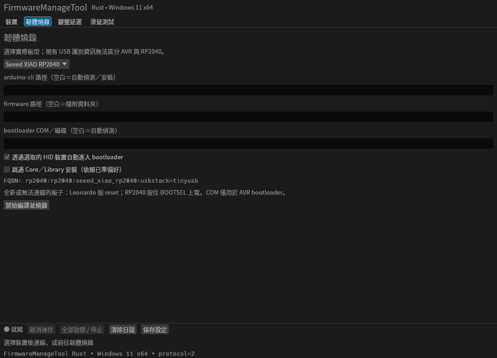

# FirmwareManageTool Rust

以 Rust 2024 撰寫的 Windows 11 x64 工具：硬體層與背景工作是一個 Rust 程式庫，
介面是 **Tauri 2 + React 19 + TypeScript + Vite**（原本的 egui／eframe 介面已移除）。
目標板只有 Seeed XIAO RP2040，韌體是**純 Rust**（embassy-rp／embassy-usb）。本分支已移除 Leonardo／AVR、Pico、
其他 arduino-pico 板型，以及整套 Arduino／TinyUSB／C++ 實作——不再需要 arduino-cli、Pico SDK 或 picotool。
韌體 3.1.0 僅使用 Vendor HID v3 二進位協定，支援實體 HID usage、NKRO、七種多媒體鍵與 8 個 session。管理工具、兩個 MSCV 與 EvanRemote 均使用 v3。

## 建置

需求：Rust 2024 工具鏈、Node.js 20 以上、Windows 上的 WebView2（Windows 11 內建）。

```bash
npm --prefix ui ci                     # 前端相依
npm --prefix ui run build              # 產生 ui/dist（Tauri 編譯時會嵌入）
cargo build --release -p firmware-manage-tool-app
```

`src-tauri` 在編譯時就把 `ui/dist` 包進執行檔，所以**任何碰到 src-tauri 的 cargo 指令之前都要先 build 前端**，
否則會得到「frontendDist 不存在」。`scripts/preflight.sh` 已經照這個順序排好（前端 → fmt → clippy → 測試 →
sync check → IPC 契約檢查）。

開發時開兩個終端：

```bash
npm --prefix ui run dev                                  # Vite，127.0.0.1:5173
cargo run -p firmware-manage-tool-app --no-default-features   # 連 dev server（HMR）
```

沒有板子也能看介面：`npm --prefix ui run dev` 後開 `http://127.0.0.1:5173/?mock=1`，
假後端會實作全部命令並每 150 ms 推一次狀態；`npm --prefix ui run preview -- --host 127.0.0.1` 則用來驗打包後的 dist。

前端與 Rust 的命令清單、事件清單由 `node scripts/check-ipc.mjs` 機械比對（真相來源是
`generate_handler![...]` 與 `enum UiEvent`），改名沒同步會直接紅燈。

## Windows 使用

解壓可攜式 ZIP，保留 `FirmwareManageTool.exe` 旁的 `firmware` 資料夾，執行 exe。
執行本身不需要 Rust、Visual Studio 或額外的 HID driver（只有「編譯並燒錄韌體」那一步需要 Rust 工具鏈）。
正式建置靜態連結 MSVC CRT。

1. 在「裝置」掃描並選取 Vendor HID，再連線。多裝置不自動取第一台。
2. 「即時狀態」每 150 ms 自動查詢 STATUS：八個計數器各一張卡片（received／completed／pending／lease／
   rx／tx／hid／failsafe），單調計數器畫每樣本增量、gauge 畫原值，保留最近 90 秒。
   傳輸計數增加會標紅，只有 failsafe 增加則提示「有程式沒有送出 CLOSE」。
   「診斷」區每秒讀一次 STATUS_EXT：uptime、tick 最大延遲、三條佇列水位、session 數、
   最近故障與距今時間、reset 原因、開機次數、Caps/Num/Scroll 與 build hash。
3. 在「韌體燒錄」直接開始編譯／上傳 XIAO 韌體：管理工具會 `cargo build` 目標
   `thumbv6m-none-eabi`、打包 UF2，再請裝置進 BOOTSEL 並複製檔案。需要已安裝的 Rust 工具鏈
   （可選擇略過 `rustup target add`）；也可指定 cargo.exe 的完整路徑。
4. 正常韌體沒有 COM 埠。無法由 HID 重啟時請按住 BOOTSEL 上電。
   可指定 UF2 磁碟；多候選由 GUI 選擇。
5. 「鍵盤延遲」提供一般、高精度及可選的極限模式，並可匯出 CSV。
   測試 A 鍵，請勿操作實體鍵盤。極限量測使用獨立子程序，GUI 維持一般優先權。
6. 「滑鼠測試」包含擬人化／原始移動、拖曳、點擊、五鍵與雙軸滾輪。
   主機計算主顯示器目標／曲線並以相對滑鼠位移輸出，請先將游標放在主顯示器內。
   新版韌體 只有一個相對滑鼠；畫面上的目標定位不使用絕對 HID。

「全部放開／停止」在工作中會取消操作並清理；正常結束送 CLOSE（立刻歸還名額、不計 failsafe）。
連線先查詢 Feature 14，再建立獨立 session；舊 v2／serial 設備直接顯示不支援。
釋放／屏障等待 USB 傳送完成，再由 STATUS 確認。拔線後顯示未知，重連建立自己的空狀態。
每 500ms 續租，租約 2 秒（只當程式崩潰或直接拔線的保險）。最多八個程式同時連線；
個別釋放、協議故障與租約到期保留其他程式，USB／共用佇列故障釋放所有 session。
STATUS 的輸入與待送數只屬於查詢者。
需重新燒錄 3.1.0；第一次從舊韌體升級使用 BOOTSEL。
序號取自 RP2040 unique ID。燒錄前關閉其他控制程式並等 2 秒。

設定與 UF2 建置產物儲存在
`%LOCALAPPDATA%\FirmwareManageTool_Rust`。設定會於開始工作、保存設定及離開時保存。
首度燒錄需要可用的 Rust 工具鏈與 `thumbv6m-none-eabi` target；缺少時會終止後續流程。

## Windows 開發與發行

以下開發指令在本專案原始碼目錄執行。

安裝 Rust stable（目前以 1.98.1 驗證）、Visual Studio Build Tools 的「Desktop
 development with C++」及 Windows SDK。於 PowerShell 執行：

```powershell
cargo run --locked --target x86_64-pc-windows-msvc
./scripts/build.ps1
```

不要加 `--target x86_64-pc-windows-msvc`。在 Windows 上 host 本來就是這個 triple，而 cargo 會把
build script／proc macro 這類 host-only 產物放在 `target/<profile>`、目標產物放在
`target/<triple>/<profile>`；明寫 triple 等於把整套依賴編兩次（本專案曾因此累積到 17 GB）。
維持一種慣例：不加 `--target`，只有 `target/debug` 與 `target/release`。要清掉可重建的樹：

```powershell
./scripts/prune.ps1          # 只列大小，不動檔案
./scripts/prune.ps1 -Apply   # 刪除 target/debug、firmware/app/target/debug 等
```

`build.ps1` 執行 fmt、Clippy、測試與 MSVC Release 建置，然後輸出
`dist/FirmwareManageTool_Rust-0.1.0-windows-x64.zip`。
ZIP 包含 exe、韌體、文件與第三方授權資料。僅重新打包時使用 `scripts/package.ps1`。
Windows EXE 與 ZIP 僅在 Windows 原生 MSVC 環境建置及打包；建置／打包腳本會拒絕在 Linux 執行。
GitHub Actions workflow 已提供，但目前不代表已在遠端執行。

## Linux 開發檢查

```bash
cargo test --locked --workspace --no-default-features
cargo test --locked --workspace --all-targets
cargo clippy --locked --workspace --all-targets -- -D warnings
cargo fmt --all -- --check
python3 scripts/sync-input-protocol.py --check
bash scripts/test-rp2040.sh
cargo build -p firmware-engine --release --target thumbv6m-none-eabi
```

Linux 可驗證純邏輯及 GUI 版面；實體 HID、量測與 bootloader 功能限定 Windows。
Linux 開發執行原始碼檢查、測試及 XIAO 韌體編譯，不產生 Windows EXE 或 ZIP。
Linux GUI 字型使用系統 Noto CJK；Windows 使用系統 Microsoft JhengHei。

架構、期限與限制見 [docs/architecture.md](docs/architecture.md)。
本分支的冗餘盤點與原生 Rust 遷移評估見 [docs/rp2040-xiao-only-analysis.md](docs/rp2040-xiao-only-analysis.md)。

Linux 離線介面預覽（尚未連接硬體）：



驗證紀錄與實機驗收清單見 [docs/validation.md](docs/validation.md)。
線路協定見 [firmware/PROTOCOL.md](firmware/PROTOCOL.md)。

## 授權

新 Rust 程式採 MIT；隨附韌體及第三方程式依原有授權。
見 [THIRD_PARTY_NOTICES.md](THIRD_PARTY_NOTICES.md)。
